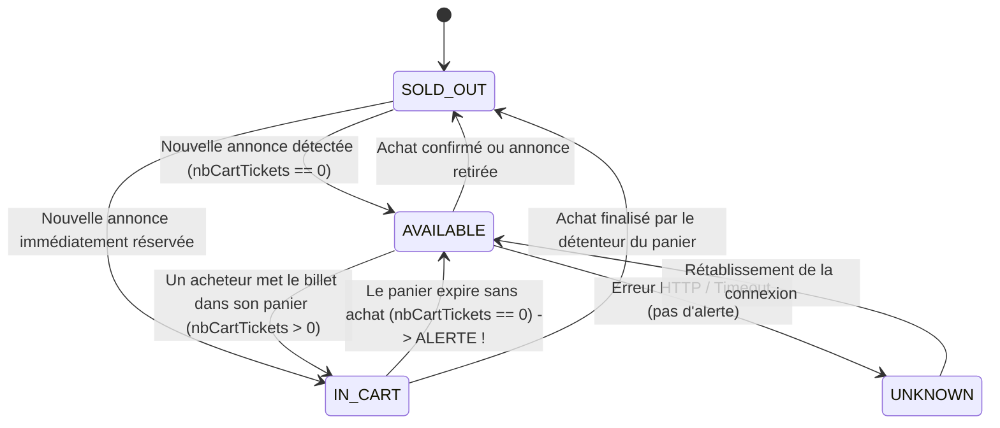

# Spécification Technique — Dream Nation 2026 Ticket Availability Monitor

## 1. Contexte & Objectifs

- **Projet :** Service de surveillance autonome de la billetterie officielle See Tickets Resell pour **Dream Nation 2026**, session du **Vendredi 30 octobre 2026**.
- **Besoin :** Acheter 2 billets PASS 1 JOUR VENDREDI.
- **Objectif fonctionnel :** Détecter immédiatement la mise en vente de billets, distinguer les vraies disponibilités des réservations en panier, et envoyer des alertes instantanées sur iPhone via Telegram avec lien direct d'achat vérifié.
- **Contraintes strictes :**
  - Aucun achat, mise au panier ou paiement automatisé (conformité CGU & éthique).
  - Aucun contournement de CAPTCHA ou antibot.
  - Surveillance passive en lecture seule sur l'API publique See Tickets.
  - Fonctionnement autonome 24h/24 en conteneur Docker.

---

## 2. Architecture & Modules

Le projet est structuré en modules Python 3.12+ indépendants et testables unitairement :

```
ticket-availability-monitor/
├── src/
│   ├── __init__.py
│   ├── config.py           # Configuration typée et validation des variables d'environnement
│   ├── models.py           # Modèles de données (Advert, Ticket, State)
│   ├── db.py               # Persistance SQLite & historique des états
│   ├── client.py           # Client HTTPx asynchrone pour l'API See Tickets
│   ├── notifier.py         # Client Telegram Bot (alertes billets & alertes techniques)
│   └── monitor.py          # Boucle principale d'orchestration et machine à états
├── tests/
│   ├── __init__.py
│   ├── conftest.py         # Fixtures et jeux de données simulés
│   ├── test_client.py      # Tests du client HTTP et de la résilience réseau
│   ├── test_notifier.py    # Tests du formattage des messages Telegram et déduplication
│   ├── test_db.py          # Tests de persistance SQLite
│   └── test_monitor.py     # Tests de la machine à états (0, 1, 2 billets, panier, retour de panier)
├── scripts/
│   └── test_notification.py# Script CLI pour tester immédiatement les alertes Telegram
├── Dockerfile              # Image Docker optimisée Python 3.12-slim
├── compose.yaml            # Définition Docker Compose avec healthcheck et volume persistant
├── .env.example            # Modèle de configuration
├── pyproject.toml          # Dépendances du projet (httpx, pydantic, etc.)
└── README.md               # Guide complet d'exploitation et maintenance
```

---

## 3. Données & Définition des États

### Identifiants See Tickets :
- Site ID : `496`
- Event ID : `2768`
- Catégorie : `7897` (`DREAM NATION 2026 - PASS 1 JOUR VENDREDI`)
- URL de base : `https://resell.seetickets.com`
- URL de catégorie : `https://resell.seetickets.com/dreamnation2026/category/7897/dream-nation-2026-pass-1-jour-vendredi`

### Machine à états :


- **`AVAILABLE` :** `nbAvailableTickets > 0` ET `(nbCartTickets == 0 OU nbAvailableTickets > nbCartTickets)`. Offre réellement achetable.
- **`IN_CART` :** `nbAvailableTickets > 0` ET `nbCartTickets >= nbAvailableTickets`. Offre visible mais verrouillée par un panier.
- **`SOLD_OUT` :** Aucun billet disponible (`hydra:totalItems == 0` ou offre disparue).
- **`UNKNOWN` :** Timeout, 5xx, 429, payload invalide. N'est jamais interprété comme une disponibilité.

---

## 4. Notifications Telegram

- **Format des messages de disponibilité (HTML) :**
  - En-tête : `🎪 <b>Dream Nation 2026</b> — <i>Vendredi 30 Octobre 2026</i>`
  - Statut : `🚨 <b>2+ BILLETS DISPONIBLES !</b>` (si >= 2) ou `🎟️ <b>Billet disponible !</b>` (si 1)
  - Détails :
    - Nombre de billets : `X billet(s)`
    - Prix unitaire : `XX,XX €` (frais inclus)
    - Date de détection : `22/10/2026 à 20:15:00 (Paris)`
  - Action : Lien vérifié cliquable vers `https://resell.seetickets.com/dreamnation2026/category/7897/dream-nation-2026-pass-1-jour-vendredi?advert={id}`
- **Règles de déduplication :**
  - Une annonce disponible déjà notifiée n'est pas re-notifiée si son état n'a pas changé.
  - **Retour de panier :** Si une annonce passe de `IN_CART` à `AVAILABLE`, une nouvelle notification est immédiatement déclenchée avec la mention `🔄 <b>Billet de nouveau disponible (panier expiré) !</b>`.
- **Alerte technique :**
  - Notification distincte en cas d'erreurs consécutives prolongées (ex. 10 échecs consécutifs / ~2 minutes) ou rétablissement de la surveillance.

---

## 5. Résilience & Exploitation

1. **Client HTTP :**
   - Timeout strict (10 secondes).
   - Backoff exponentiel en cas de HTTP 429 ou 5xx : délai progressif (2s, 4s, 8s, 16s, max 60s).
   - Prise en compte de l'en-tête `Retry-After`.
2. **Arrêt automatique :**
   - Heure limite : `2026-10-31T05:00:00+02:00` (fin de l'événement). Le service s'arrête proprement avec log et notification facultative.
3. **Persistance SQLite :**
   - Conserve l'état de chaque annonce entre les redémarrages.
   - Table d'historique des changements d'état pour audit et traçabilité.
